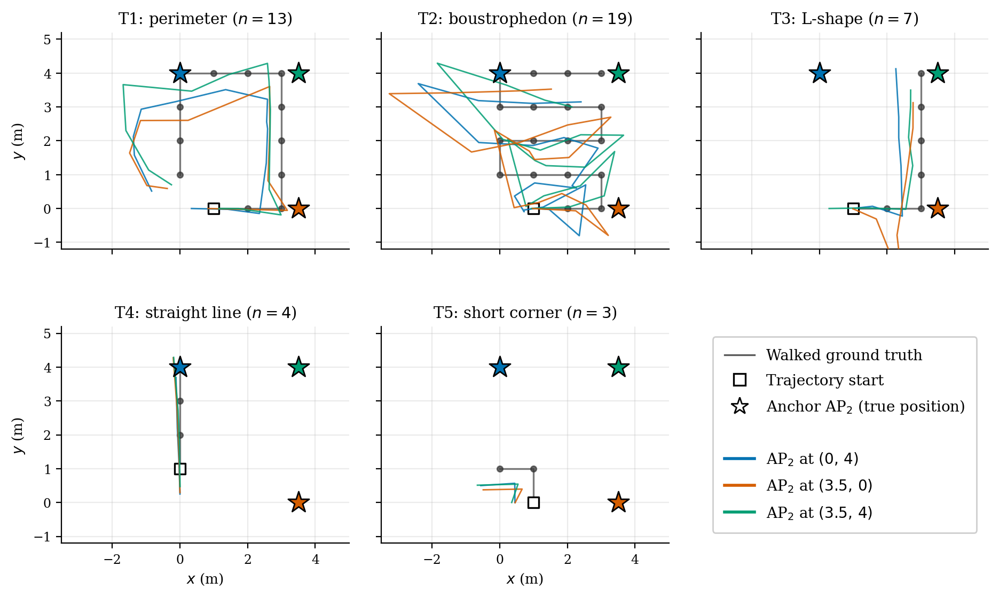

# MobileAP: locating Wi-Fi access points with a phone

An Android app that estimates where an **unknown Wi-Fi access point** is, using a phone walking around
a room. Group class project for Advanced Wireless Networks (2026).

**How it works**

1. **Ranging:** the phone measures its distance to a known *anchor* AP with Wi-Fi Fine Timing
   Measurement (FTM / IEEE 802.11mc round-trip time). Raw distances are linearly calibrated
   (`CalibrationActivity`) and corrected for the phone's height above the AP.
2. **Tracking the phone:** an Extended Kalman Filter (`FusionEstimator`) fuses FTM distances to the
   anchor with heading from the gyroscope (game rotation vector). The process noise is stretched along
   the walking direction, and the measurement noise grows with distance.
3. **Locating the unknown AP:** while walking, the app ranges the unknown AP from many tracked
   positions and solves for its location by multilateration (least squares on the linearised circle
   equations).

**Results** (final build, 18 runs; full write-up in [`results.md`](results.md)):

- Phone position error: median **0.73 m** (90th percentile 1.60 m) over 138 waypoints.
- Unknown-AP error: best **0.41 m**, median **2.10 m**; 7 of 18 runs under 2 m.
- Accuracy depends mostly on geometry: trajectories that don't surround the unknown AP do worst.

## Repository

| Path | |
| --- | --- |
| `app/src/main/java/com/group2/wififtm/` | The app: `ApLocatorActivity` (main experiment), `FusionEstimator` (EKF), `CalibrationActivity`, `MotionPositionEstimator`, `OrientationActivity`, `TrajectoryView` |
| `data/` | Logged runs: per-waypoint ground truth vs estimate for 5 trajectories × 3 AP positions |
| `figures/` | Analysis plots; `figures/report/` holds the report figures |
| `results.md` | Every experiment, what changed between them, and the final evaluation |
| `notes.pdf` | Project notes |

## Build

Open in Android Studio and run on a phone with Wi-Fi RTT support (Android 9 / API 28 or newer), with
location permission granted. Both APs must support 802.11mc FTM.
